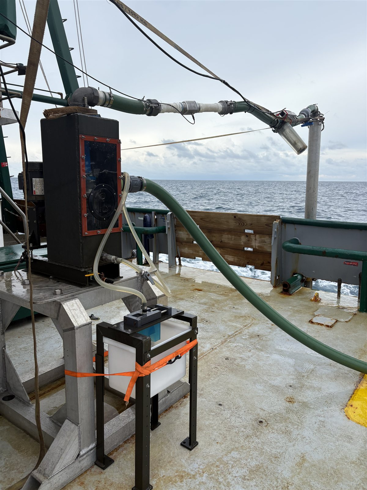
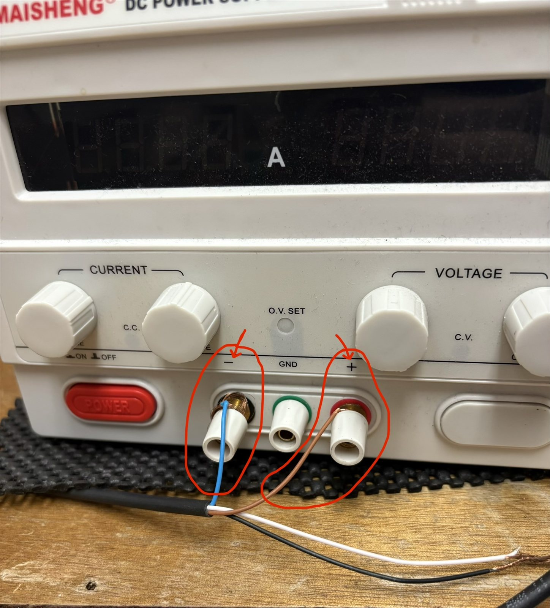
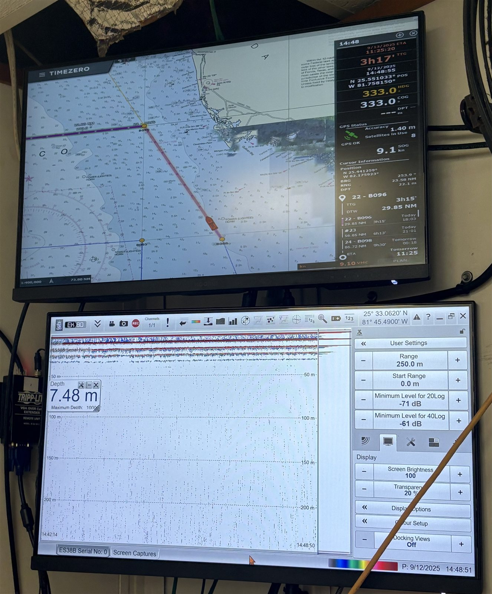

# SHELF SOP 2: Field Collection of Fish Eggs Using CUFES

**Authors**: Christopher Stallings, AliciaGrace Marley \
**protocols.io**: to be published (DOI to be added)

---

## 2.1 Purpose and scope

This SOP describes how SHELF collects fish eggs along transects while a
research vessel is underway, using a Continuous Underway Fish Egg Sampler
(CUFES). The method follows the CUFES design of Checkley et al. (1997), as
used by NOAA SEAMAP. SHELF has used it on FIO cruises since 2024. Once
preserved, egg samples are stable and can be transported to the lab for DNA
barcoding (SOP 3).

Terms such as station, transect, TransectID, and cruise code are defined in the
SOP 1 glossary. All cruise personnel must review SOP 1, Section 1.6 (Safety
and injury reporting) before departure.

---

## 2.2 Materials

### 2.2.1 CUFES parts

- CUFES
- CUFES intake hose and output hose
- Sample collection sink, with intake hose and output hose
- Electric seawater pump box
- Water flow meter and flow meter power cable
- DC power supply box for the flow meter, and its power cable
- Spare motor
- Spare speed reducer
- Tool kit

### 2.2.2 Sample processing materials

- 5 gal denatured 95% ethanol (Fisher Scientific #04-355-455)
- 500 glass collection vials, 20 mL (Fisher Scientific #03-341-25S)
- 500 vial cap labels (Shamrock Labels #SDL-50-1)
- 500 vial labels (supplied by NOAA SEAMAP)
- Angled sieve for the collection sink (500 µm mesh), plus a spare
- Sieve cup for sample processing (500 µm mesh), plus a spare
- Forceps
- Liquid cement for repairing sieve mesh
- Toothbrush for cleaning sieves
- Vial stand
- Funnel for washing samples into vials
- Ethanol wash bottle
- Ethanol carboy, with lab tape to mark the fill line

### 2.2.3 Data recording materials

- Datasheets and pencils
- Laptop and power cord

---

## 2.3 Before departure

1. Review SOP 1, Section 1.6 (Safety and injury reporting). Carry the
   Amerisys number (1-800-455-2079) and the USF Accident Report link.
2. Grease the CUFES zerk fittings with marine-grade grease.
3. Clean the CUFES egg basket, angled sieve, and sieve cup with a toothbrush
   and vinegar.
4. Print new datasheets.
5. Create the cruise spreadsheet and share it with the shift leads, with
   editing rights. Use these columns:
   - Cruise Code
   - Date
   - TransectID (e.g., `WB2410_B111.1`)
   - Observers
   - Start Time (24 h)
   - Start Latitude
   - Start Longitude
   - Start Depth (m)
   - Start Flow Rate (L/min)
   - Start Total Volume (m³)
   - End Time (24 h)
   - End Latitude
   - End Longitude
   - End Depth (m)
   - End Flow Rate (L/min)
   - End Total Volume (m³)
   - Notes
6. Load the CUFES on board and install it (Figure 2.1).
7. Store ethanol in flammables storage, following the vessel's rules.
8. Share Section 2.9 (what to bring, and seasickness) with anyone going to
   sea for the first time.

{width=55%}

---

## 2.4 Departure-day setup

Do these steps after the collection pole is mounted.

1. Connect the flow meter to the DC power supply (Figure 2.2):
   1. Attach the flow meter power cables to the DC power supply: blue wire
      to (−), brown wire to (+). The white and black wires are not
      connected.
   2. Plug the DC power supply into a wall socket and turn it on.
   3. Use the dials to set the power supply to about 0.14 A and 15.93 V.
      This does not need to be exact, but do not exceed 30 V DC.
2. Work with the marine technician to set up the displays used for data
   recording (Figure 2.3):
   1. a chart plotter showing depth (m) and latitude/longitude in decimal
      degrees
   2. the planned route, with the ETA at the next station

{width=55%}

{width=55%}

---

## 2.5 Transects and TransectIDs

Each 30-minute collection is one transect. Its TransectID is
`[CruiseCode]_[Station].[N]`, where N is the transect number. Transects are
numbered in the order they are taken, starting from the station: `.1` is
the transect that begins on station, `.2` is the next, and so on (e.g.,
`WB2410_B111.1`, `WB2410_B111.2`). Do not zero-pad the transect number
(`.1`, not `.01`).

**The 35-minute rule.** Do not start a new transect if the vessel will reach
the next station in less than 35 minutes. The captain and the on-duty
science crew confirm the time to the next station by radio before each new
transect.
Leave the angled sieve off the collection sink until the next station is
reached.

---

## 2.6 Sample collection and processing

### 2.6.1 Starting a transect

1. On arrival at a station (or at the end of the previous transect), enter
   the cruise code, date, TransectID, observers, and start data in the
   spreadsheet.
2. Place the angled sieve on the collection sink:
   - Slide the angled sieve all the way up the sink output sleeve.
   - Push the weighted slider on top of the sink fully over to the side
     where the angled sieve is installed.
3. Start a 30-minute timer.
   - If you use a phone as the timer, turn off automatic time-zone changes.
     The cruise track may cross time zones (between Eastern and Central), which affects both the data and
     shift changes.
   - If two people work the same shift, both should set timers.

### 2.6.2 Ending a transect

1. At 30 minutes, record the end time, latitude, longitude, depth, flow
   rate, and total volume in the spreadsheet.
2. Remove the angled sieve from the collection sink output.
3. Rinse the sieve contents into the sieve cup with the ship's flowthrough
   seawater. Concentrate the contents along one inner edge of the cup.
4. Place the funnel in a collection vial.
5. Use the ethanol wash bottle to rinse all the sieve cup contents into
   the funnel without overflowing the vial. For large samples, use forceps
   gently to help move the material into the vial.
6. Fill in a vial label (Figure 2.4): the station and transect number
   (e.g., `B111.1`) and the date on the front, and the cruise code and the
   time of collection on the back. Together, the cruise code and the
   station and transect number make the TransectID (`WB2410_B111.1`).
   Place the label inside the vial.
7. Write the TransectID on a cap label and attach it to the vial cap.
8. Screw on the cap.
9. Rinse the angled sieve, sieve cup, and funnel with flowthrough seawater.
10. Unless the 35-minute rule applies (Section 2.5), reinstall the angled
    sieve and start the next transect (Section 2.6.1). The end of one
    transect is the start of the next.

**Samples that need more than one vial.** Use as many vials as needed, and
add a vial number after the TransectID on each label (e.g., `B119.2.1`,
`B119.2.2`). The vial number is not part of the TransectID: all vials from
one transect share one TransectID (SOP 4, Section 4.2.2).

::: {layout-ncol=2}

:::

*Figure 2.4. Vial label, front and back.*

---

## 2.7 End of cruise and data handoff

1. Keep the vials upright in a closed box and transport them to the lab at
   room temperature. Record the handoff: date, who received the samples,
   and number of vials.
2. Scan the paper datasheets as `datasheets_[CruiseCode]_[YYYYMM].pdf`.
3. Export the cruise spreadsheet as a CSV.
4. Ask the marine technician for the flowthrough and echosounder files and name them `environmental_[CruiseCode]_[YYYYMM]`.
5. Upload all files to `01_Data/02_tables/staging/` and notify the PI and
   the PI's lab manager (SOP 4, Section 4.4.1).
6. Clean the CUFES, sieves, and sieve cup (as in Section 2.3, step 3). Dry
   and store them.

---

## 2.8 Troubleshooting

| Problem | Solution |
|---------|----------|
| Mesh on the angled sieve or sieve cup comes loose | Let it dry, then glue the mesh back on with liquid cement. Let the glue cure for 12 hours before use. Use the spare in the meantime. |
| Sample does not fit in one vial | Use more vials, numbered as described in Section 2.6.2. |

---

## 2.9 Cruise preparation for participants

### What to bring

- Closed-toe shoes (required on board), and waterproof boots or shoes,
  since the deck is often wet
- Shower shoes
- Rain gear
- Hat and sunscreen
- Toiletries and any medications you take (the ship has showers)
- A watch for timing transects
- An extra pillow and towel, if you want them
- Something for down time (book, work, laptop). The ship's internet is
  usually fast enough for video calls and streaming.
- Seasickness remedies (see below)

### Not needed

- Linens. The ship supplies towels, sheets, blankets, and pillows.
- Food. Meals are provided, though you can bring snacks. Give any dietary
  needs to the PI's lab manager before the cruise.
- Alcohol, illegal drugs, and firearms are not allowed on board.

### Arrival and parking

On departure morning you can park beside the vessel to unload your gear,
then move your vehicle to an approved parking space. If you do not have a
campus parking pass, contact the PI's lab manager before the cruise to
arrange parking.

### Seasickness

Talk with a physician or pharmacist before using any medication.

- **Dramamine** (oral, over the counter). Take it *before* you feel queasy,
  especially in the first few days of a cruise. The main side effect is
  drowsiness.
- **Scopolamine patch** (prescription, worn behind the ear). If you have
  never used it, try it before the cruise. In a small number of people it
  causes serious side effects, including confusion and hallucinations.
- **Acupressure wristbands**, which press on a point on the wrist that can
  relieve nausea.
- **Real ginger**: ginger ale made with real ginger, ginger candies, or
  pickled ginger. These can help once you start to feel nauseated.
- **Food and drink.** Notice what upsets your stomach and what settles it.
  Acidic drinks such as coffee upset some people, so consider cutting back
  at sea. Bland foods help others.

For more advice on going to sea for the first time, see Yoder (2025).

---

## References

Checkley DM Jr, Ortner PB, Settle LR, Cummings SR (1997) A continuous,
underway fish egg sampler. *Fisheries Oceanography* 6:58–73.
<https://doi.org/10.1046/j.1365-2419.1997.00030.x>

Yoder M (2025) *Life and Science at Sea: Advice for Your First Scientific
Research Cruise from Experienced Oceanographers.* Boston College.
<https://wrs.umn.edu/sites/wrs.umn.edu/files/2025-03/lifeandscienceatsea.pdf>
