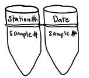
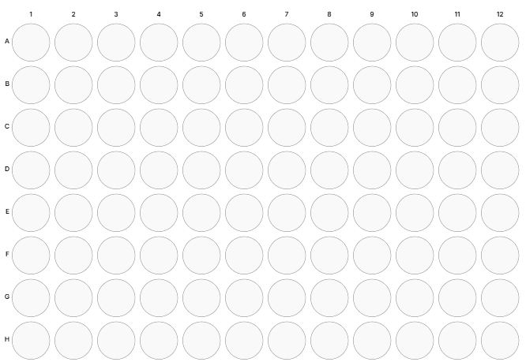
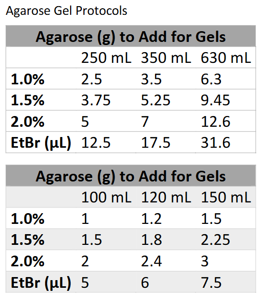
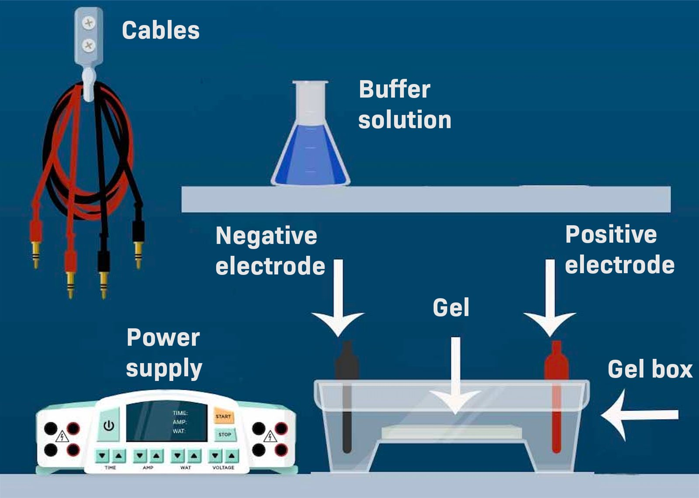
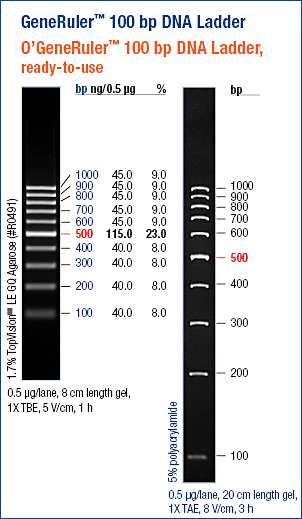

# SHELF SOP 3: DNA Barcoding of Fish Eggs

**Authors**: Mya Breitbart, Makenzie Kerr \
**protocols.io**: <https://doi.org/10.17504/protocols.io.q2lydz4rmlx9/v1>. Replaces Breitbart and Kerr (2025), <https://doi.org/10.17504/protocols.io.3byl4wmbjvo5/v1>.

---

## 3.1 Purpose and scope

This SOP describes how fish eggs collected under SOP 2 are picked, counted,
and identified to species by DNA barcoding of the mitochondrial COI gene.

The method is destructive: there is only one chance to extract DNA from
each egg. Extracted DNA has remained usable for more than five years at
−20 °C. Many of the reagents can be replaced with equivalents.

Terms such as TransectID and contig are defined in the SOP 1 glossary. All
lab personnel must read SOP 1, Section 1.6 (Safety and injury reporting). The
data produced here are submitted as described in SOP 4.

---

## 3.2 Materials

| Item | Source |
|------|--------|
| Ethanol, 100%, molecular biology grade | Fisher Scientific #BP2818500 |
| DNA-grade water, DNase/protease free (PCR water) | Fisher Scientific #BP24701 |
| 10 M NaOH | MilliporeSigma #72068 |
| 0.5 M disodium EDTA | MilliporeSigma #4055 |
| 1 M Tris-HCl | Fisher Scientific #BP2473-1 |
| Agarose powder | ApexBio Technology #20-101 |
| Ethidium bromide, 1% solution | Fisher Scientific #BP130210 |
| Flat PCR caps, strips of 12 | Fisher Scientific #AB0851 |
| AlumaSeal II sealing films | Fisher Scientific #AF100 |
| BSA, 20 mg/mL | Fisher Scientific #FERB14 |
| dNTPs | Genesee Scientific #42-403 |
| Red Taq and buffers (NH4, MgCl2) | Genesee Scientific #42-401R |
| GeneRuler DNA ladder | Fisher Scientific #SM0334 |
| Screw-cap tubes and caps, 1.5 mL | Genesee #21-262, #21-266A |
| Square gridded petri dishes | Andwin Scientific #70691CS |
| PCR tubes (strips) | Genesee #22-705A |
| 96-well PCR plates | Eppendorf #0030531043 |

---

## 3.3 Picking eggs

Egg picking produces the egg count data (SOP 4, Section 4.4.3).

1. Prepare one 1.5 mL screw-cap tube per sample and label it with the
   TransectID.
2. Make 70% ethanol in a Falcon tube (7 parts 100% ethanol to 3 parts DI
   water). Pipette about 1 mL into each tube.
3. Turn on the light of a dissecting scope with dark-field illumination.
4. Pour the contents of one sample vial into a square, gridded petri dish.
   Use a disposable pipette and the ethanol in the dish to rinse out eggs
   stuck in the vial. You only need to recover the eggs, not all of the
   plankton.
5. Search the dish square by square (Figure 3.1). This
   avoids a bias toward large or small eggs. Continue through the whole
   dish or until you have picked **96 eggs**.
6. Pick each egg with forceps (PL-30) and place it in the screw-cap tube.
   - Avoid picking up other plankton or popping eggs.
   - Push each egg into the ethanol so it does not dry out.
   - Keep count with a counter clicker.
7. Count the eggs remaining in the dish.
8. Place a clean petri dish under the vial to catch spills, and carefully
   pour the contents of the picking dish back into the vial.
   - Rinse the dish with a disposable pipette and the ethanol in the vial,
     adding 70% ethanol if needed. Do not overflow the vial.
   - Add anything spilled onto the extra dish to the vial.
9. If the sample has more than one vial, repeat steps 4–8 for each vial
   until 96 eggs are picked, and count the eggs in every vial.
10. Record the egg counts for the sample (SOP 4, Section 4.4.3):
    - TransectID
    - EggsPicked
    - EggsTotal (picked plus remaining, across all vials)
    - DatePicked
    - Time_min (picking time, if recorded)
    - Obs (observer initials)
11. Store the tubes and vials at room temperature.
12. Rinse the dish with water and wipe the forceps with ethanol. Turn off
    the microscope.

{width=30%}

---

## 3.4 DNA extraction (HotSHOT)

DNA is extracted with the HotSHOT method (Truett et al. 2000), as applied
to zooplankton eggs by Montero-Pau et al. (2008) and to fish eggs by
Burrows et al. (2018).

### 3.4.1 Reagents

**Alkaline lysis buffer.** Make fresh every 1–2 months and store at room
temperature.

- 25 mL PCR water
- 62.5 µL 10 M NaOH (base cabinet)
- 10.0 µL 0.5 M disodium EDTA (chemical cabinet, right side)

**Neutralization reagent.** Store at room temperature.

- 24 mL PCR water
- 1 mL 1 M Tris-HCl

### 3.4.2 Extraction

1. Move each egg into its own PCR tube (PCR strips) with a sterile pipette
   tip (10–100 µL pipette, depending on egg size). Remove the excess
   ethanol. Tips:
   - Choose a tip slightly larger than the egg.
   - Push all the air out of the tip before picking up the egg, and keep
     pressure on it so it stays on the tip as you lift it out.
   - If an egg goes up into the tip, gently flush it out with ethanol. If
     it is stuck, cut off the end of the tip and try again.
2. Add 50 µL alkaline lysis buffer. Crush the egg against the side of the
   tube with a sterile toothpick or pipette tip.
   - Sterilize toothpicks in a small tri-pour beaker on the autoclave dry
     cycle.
   - If the egg is hard to pop, remove the liquid, pop the egg, then add
     the liquid back.
3. Incubate the tubes at 95 °C for 30 minutes in a thermocycler or block
   incubator. Set the plate to 95 °C and the lid to 56 °C, with no timer.
   Make sure the caps are tight, or they will pop off. Set a separate timer
   for 29 min 30 s so you have time to remove the tubes.
4. Cool the tubes on ice for 3–4 minutes, then centrifuge briefly to spin
   down condensation.
5. Add 50 µL neutralization reagent to each tube.
6. Vortex and centrifuge briefly. This is the DNA template. Use 2 µL for
   PCR, or store at −20 °C in a box labeled with the year, your initials,
   and "fish eggs".

---

## 3.5 PCR

### 3.5.1 Primers

SHELF uses the fish COI primer cocktail of Ivanova et al. (2007):

| Primer | Sequence (5′–3′) |
|--------|------------------|
| VF2_t1 | TGTAAAACGACGGCCAGTCAACCAACCACAAAGACATTGGCAC |
| FR1d_t1 | CAGGAAACAGCTATGACACCTCAGGGTGTCCGAARAAYCARAA |
| FishF2_t1 | TGTAAAACGACGGCCAGTCGACTAATCATAAAGATATCGGCAC |
| FishR2_t1 | CAGGAAACAGCTATGACACTTCAGGGTGACCGAAGAATCAGAA |

**Reconstituting new primers.** Add DNA-free water to the dry primer (x µL,
equal to the number of ng of DNA on the primer tube). Vortex until
dissolved and spin down.

**Primer cocktail (10 µM).** Add 100 µL of each primer to a 1.5 mL tube,
then add 600 µL DNA-free water. Smaller batches work the same way (e.g.,
25 µL of each primer and 150 µL water).

### 3.5.2 Thermocycler program (`Fish45`)

| Step | Temperature | Time |
|------|-------------|------|
| Initial denaturation | 94 °C | 2 min |
| 45 cycles | 94 °C | 30 s |
| | 52 °C | 40 s |
| | 72 °C | 1 min |
| Final extension | 72 °C | 10 min |

### 3.5.3 Setting up the reaction

1. Turn on the thermocycler and load the `Fish45` program.
2. Bleach and UV the hood, pipettes, and rack.
3. Fill a small cooler one-third full of ice. Thaw the DNA on the ice,
   flicking occasionally to mix. Bury the Red Taq in the ice.
4. Thaw the other reagents on the bench (primers, dNTPs, NH4 buffer, MgCl2,
   BSA). Vortex and spin down all reagents except the DNA (flick and spin)
   and the Red Taq (spin only).
5. While the reagents thaw, label the tubes in numerical order, including a
   negative control (Figure 3.2). Write the station and date at the top of each tube and
   the egg number in the middle.
6. If using a 96-well plate, label its side with the date, stations, and
   your initials, and record the sample layout on a plate map (Figure 3.3).
7. Work quickly and keep the DNA and Taq on ice. Prepare a master mix for
   the number of templates plus one negative and one extra. For a 96-well
   plate, make enough for 100 reactions to allow for loss in the
   multichannel reservoir. Per 50 µL reaction:

   | Reagent | Volume (µL) |
   |---------|-------------|
   | Water | 38 |
   | 10X NH4 buffer | 5 |
   | 50 mM MgCl2 | 1.5 |
   | BSA | 0.5 |
   | 10 µM primer cocktail | 1 |
   | 10 mM dNTPs | 1 |
   | Taq | 1 |
   | Template (added separately) | 2 |

8. Mix all reagents except the DNA in a suitably sized tube.
9. Pipette 48 µL of master mix into each PCR tube.
10. Add 2 µL of DNA template to each tube, matching egg numbers. Add none
    to the negative control.
11. Flick the tubes and spin them down. Cover PCR plates with foil and spin
    them down too.
12. Carry everything in the cooler to the PCR room (only the tubes go into
    the room). Load the thermocycler and start the run. Check that it is
    running before you leave.
13. Take off your gloves, collect the cooler and racks, and clean up in the
    main lab: put away reagents, dump the ice, and bleach and UV the hood.
14. The run takes about 2 hours. When it finishes, press Enter to exit the
    run (check that the screen shows your program; if not, use the arrow
    keys to find it). Remove your products and turn off the thermocycler
    unless a note says otherwise.
15. Store the PCR products at −20 °C, or run a gel right away.

{width=25%}

{width=70%}

---

## 3.6 Gel electrophoresis

### 3.6.1 Pouring the gel

Make the gel while the PCR is running. A gel keeps for up to 4 days.
Change the TAE buffer in the gel box if it has particles or looks cloudy.

1. Choose the gel rig size: the small rig (150 mL) for a few strips, the
   large rig (350 mL) for a full plate. Gels are 1.5% agarose (2.25 g in
   150 mL, or 5.25 g in 350 mL of 1X TAE; Figure 3.4).
2. Add the agarose and 1X TAE to an Erlenmeyer flask and swirl gently. Do
   not fill the flask more than halfway, or it will boil over.
3. Microwave for 1 minute. Wearing heat gloves, swirl gently. Microwave
   again for about 45 seconds, or until boiling, and swirl again.
4. Set up the gel siding and combs (tape the sides if needed).
5. When the flask is cool enough to hold the bottom for 10 seconds, add
   ethidium bromide: 7.5 µL for a 150 mL gel, or 17.5 µL for 350 mL
   (5 µL per 100 mL; Figure 3.4). **Ethidium bromide is a mutagen. Wear nitrile gloves,
   handle it only in the designated area, and dispose of it as EtBr
   waste.**
6. Swirl gently and pour immediately into the gel holder. Pop or move any
   bubbles with a pipette tip.
7. Add combs, leaving room between rows for the samples to run.
8. Let the gel set for 20 minutes. Pull the combs straight up and remove
   the siding or tape.

{width=50%}

### 3.6.2 Running the gel

1. Cover the gel with at least ½ inch of 1X TAE in the gel box.
2. Put the lid on the rig and check the leads (black/negative on the left,
   red/positive on the right) before plugging into the power supply
   (Figure 3.5).
3. Get the thawed PCR products and the DNA ladder (refrigerator, pink cap).
4. Load the ladder (Figure 3.6) at the ends of each row and the samples in
   the middle.
5. Run at 120 V for 1 hour. Check that bubbles are rising on both sides.
6. Turn off the power supply.

{width=60%}

{width=35%}

### 3.6.3 Imaging and scoring

1. Cut out the part of the gel you need with a razor blade, or take the
   whole gel to the imager.
2. Clean the imager base with ethanol and Kimwipes. Turn on the UV light
   with the door open. Place the gel with the wells toward the back,
   centered.
3. Open the imager program, adjust the zoom if needed, acquire the image,
   adjust the color, and print it.
4. Remove the gel with a gloved hand. Turn off the imager and leave the
   door open. Save the image to your folder with the date.
5. Discard the gel in biohazard waste.
6. Label the printed image and put it in your notebook: lane numbers,
   ladder, and negative control. Mark the positives (bands at about
   600–700 bp). All wells should show primer dimers near the bottom (about
   100 bp).
7. **Record PCR failures.** Every egg with no band at 600–700 bp goes in the
   failed file with `FailReason = PCRFail` (SOP 4, Section 4.4.2).

### 3.6.4 Making TAE buffer

**50X TAE (concentrate).** Ingredients: 242 g Tris base (Fisher #BP152-1),
100 mL Tris-EDTA 1X solution, pH 8.0 (Fisher #BP2473-500), and 57.1 mL
glacial acetic acid (Fisher #BP1185-500).

1. In the main lab, pour the acetic acid into two Falcon tubes in the hood,
   then take them to the PCR room.
2. Measure 500 mL of DI water and pour it into a large, clean bottle.
3. Weigh out 242 g of Tris base, add it to the bottle, and shake to
   dissolve. This takes 2–3 hours: shake, wait an hour, and repeat.
4. When the Tris base is fully dissolved, add 100 mL of Tris-EDTA.
5. Add the acetic acid and mix gently (the solution will warm slightly).
6. Pour into a 1 L graduated cylinder and bring to 1 L with DI water. Pour
   back into the bottle, then label and date it.

#### 1X TAE (20 L carboy)

1. Fill the empty carboy to the 19.6 L line with DI water.
2. Add 400 mL of 50X TAE (C1V1 = C2V2: 50X × V1 = 1X × 20 L, so
   V1 = 400 mL).
3. Mix by gently rocking the carboy on the edge of the counter.
4. Leave the cap slightly loose so the spigot flows. Date and initial the
   carboy with lab tape.

Source: Sambrook and Russell, *Molecular Cloning*, Vol. 1, 3rd ed., 5.8.

---

## 3.7 Sending samples for sequencing

1. Load the unpurified PCR products into a 96-well plate, preferably one
   site per plate. Record the layout on a plate map (Figure 3.3).
2. Cap the plate with flat PCR cap strips, then add a foil seal. A tape
   dispenser or the side of a marker helps push the caps down. Label the
   plate with the date and a name that matches the order form.
3. Email the completed DNA order form to the sequencing facility (TacGen).
   Specify unpurified PCR product, primer M13F (−20), and a 700–800 bp
   product. Each egg is sequenced once, in the forward direction only.
4. Ship the plate overnight in a padded box with the printed form. Samples
   do not need to be cold. Do not ship on a Friday unless TacGen has agreed.
5. Get the account number and shipping information from the lab manager.

---

## 3.8 Sequence processing (Geneious)

Settings below were validated in Geneious 7.1.9; later versions may label
some options differently.

1. Open Geneious. **Local** is Geneious's own working database on the lab
   computer. It is not where SHELF files are stored: the files you export
   in Section 3.9 and hand off in Section 3.10 go to the shared OneDrive folder
   (SOP 1, Section 1.8.2). Work in your own folder: right-click **Local** and create
   a new folder.
2. Import the sequence files (`.ab1`) into the new folder.
3. Select all sequences. Under **Annotate & Predict**, choose **Trim
   ends** and select only:
   - Remove new trimmed regions from sequences
   - Trim primers: allow mismatches 5; minimum match length 5
   - Error probability limit: 0.05
   - Trim 5′ end: at least 3 bp
   - Trim 3′ end: at least 3 bp
4. Click off the sequence names to save.
5. Select all sequences again. Under **Align/Assemble**, choose **De Novo
   Assemble**, give the assembly a name, and set:
   - Assemble by 1st part of name, separated by hyphen
   - Assembler: Geneious; sensitivity: custom; do not trim
   - Save assembly report, list of unused reads, and contigs, in a
     sub-folder
   - Allow gaps: maximum 5% per read; maximum gap size 5
   - Minimum overlap 100; minimum overlap identity 99%
   - Word length 10; index word length 10
   - Maximum mismatches per read 1%; maximum ambiguity 16
   - Reanalyze threshold 0; speed 5
6. Open the new sub-folder. Select all contigs and choose **File → Export →
   Consensus sequences** (highest quality, assign quality: total). Create a
   sequence list and save it as FASTA.
7. Select the unused reads and choose **File → Export → Selected
   Documents**. Save as FASTA.

**Contigs and unused reads.** A contig is a consensus sequence assembled
from overlapping reads. Because each egg is sequenced once, one read is one
egg. In step 5, the reads from all eggs in a sample are assembled together,
and reads that overlap at ≥99% identity merge into one contig. Each contig
therefore represents two or more eggs from the same sample that share a
sequence, and a sample can have several contigs. Each unused read is a
single egg.

---

## 3.9 Species identification

1. Start the bench spreadsheet from `example_sequences_import.csv` in the
   staging folder, so it has the columns required by SOP 4, Section 4.4.2.
   Record:
   - each contig as one row, with `EggNumber = contig01`, `contig02`, …
     and `NumberEggs` = the number of reads in the contig
   - each unused read as one row, with its integer egg number and
     `NumberEggs = 1`
2. Go to the BOLD Identification Engine
   (https://bench.boldsystems.org/index.php/IDS_OpenIdEngine) and select
   species-level identification.
3. Paste the FASTA sequences into the BOLD search box and run the search.
   BOLD does not accept sequences shorter than 80 bp.
4. Download the results summary.
5. For each sequence, enter the scientific name of the best match, the
   probability of placement as `PercentID`, and `DNAdb = BOLD`.
   - Scroll down in the BOLD results to check each ID. Private records can
     make a match look better than it is.
   - If the result does not say "This identification is solid unless there
     is a very closely allied congeneric species that has not yet been
     analyzed," list the other candidate species in alphabetical order,
     separated by `/` (e.g., `Decapterus punctatus/tabl`).
6. Search any sequence BOLD could not identify (including those under
   80 bp) with NCBI BLAST (https://blast.ncbi.nlm.nih.gov/Blast.cgi). Enter
   the top hit, its percent identity as `PercentID`, and `DNAdb = GenBank`.
   For large batches, use BLAST's option to email the results.
7. Optional: add common names from FishBase (https://www.fishbase.se).
8. Move every sequence without an accepted identification to the failed
   file (SOP 4, Section 4.4.2), one row per egg, with a FailReason:
   - `LowPercentID`: best match below 97%. IDs below 97% are not trusted.
   - `NotEnoughBP`: sequence too short to identify
   - `NoMatch`: no match in BOLD or GenBank
   - `InvertebrateMatch`: matched an invertebrate (e.g., squid)
   - `Unknown`: the egg failed, but the cause is not known
9. Paste each sequence into the `Sequence` column from the FASTA files.
10. Make a summary chart of the accepted identifications (97% and above).

Submitted identifications are then reviewed for plausibility as described
in SOP 4, Section 4.6.2.

---

## 3.10 Data handoff

1. Save the files as:
   - `sequences_[context]_[CruiseCode]_[YYYYMM].csv` (accepted
     identifications)
   - `failed_[context]_[CruiseCode]_[YYYYMM].csv` (PCR failures and
     sequences without an accepted ID)
   - `eggcounts_[CruiseCode]_[YYYYMM].csv` (Section 3.3)
2. Upload the sequence and failed files together to
   `01_Data/02_tables/staging/`, along with the egg count file.
3. Notify the PI and the PI's lab manager (SOP 4, Section 4.4.1).

---

## References

Burrows M, Browning JS, Breitbart M, Murawski SA, Peebles EB (2018) DNA
barcoding reveals clear delineation between spawning sites for neritic
versus oceanic fishes in the Gulf of Mexico. *Fisheries Oceanography*.
<https://doi.org/10.1111/fog.12404>

Ivanova NV, Zemlak TS, Hanner RH, Hebert PDN (2007) Universal primer
cocktails for fish DNA barcoding. *Molecular Ecology Notes* 7:544–548.
<https://doi.org/10.1111/j.1471-8286.2007.01748.x>

Montero-Pau J, Gómez A, Muñoz J (2008) Application of an inexpensive and
high-throughput genomic DNA extraction method for the molecular ecology of
zooplanktonic diapausing eggs. *Limnology and Oceanography: Methods*
6:218–222. <https://doi.org/10.4319/lom.2008.6.218>

Truett GE, Heeger P, Mynatt RL, Truett AA, Walker JA, Warman ML (2000)
Preparation of PCR-quality mouse genomic DNA with hot sodium hydroxide and
tris (HotSHOT). *BioTechniques* 29:52–54. <https://doi.org/10.2144/00291bm09>
