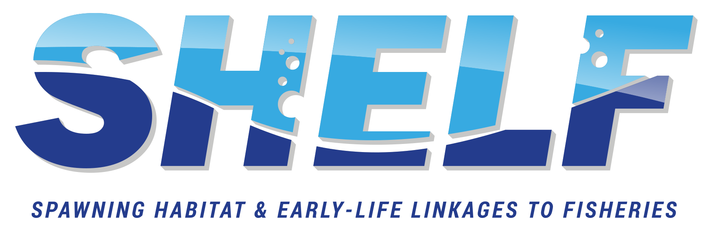

::: {.front-logo .content-visible when-format="html"}
{fig-alt="SHELF logo" fig-align="center"}
:::

::: {.content-visible when-format="docx"}
{width=4in fig-align="center"}
:::

# About these SOPs {.unnumbered}

These are the four Standard Operating Procedures (SOPs) for the Spawning
Habitat & Early-Life Linkages to Fisheries (SHELF) program. SOP 1 introduces the program and explains how
the other three fit together.

**Living document.** The SOPs are revised as methods and personnel change.
To report a problem or suggest a change, file an issue in the SHELF SOP
GitHub repository (<https://github.com/SHELF-USF/SHELF-SOP>), as described
in SOP 1, Section 1.8.4. The current version is always at
<https://shelf-usf.github.io/SHELF-SOP/>.

**How to cite.** Stallings C, Breitbart M, Kerr M, Marley A (2026). *SHELF
Standard Operating Procedures.* University of South Florida College of
Marine Science.

**Funding.** Florida Institute of Oceanography, Florida RESTORE Act Centers
of Excellence Program (FLRACEP); USF project 47101129.

**License.** The SOP text and SHELF figures are licensed under
[CC BY 4.0](https://creativecommons.org/licenses/by/4.0/). Figures credited
to another source remain under their owners' terms.
